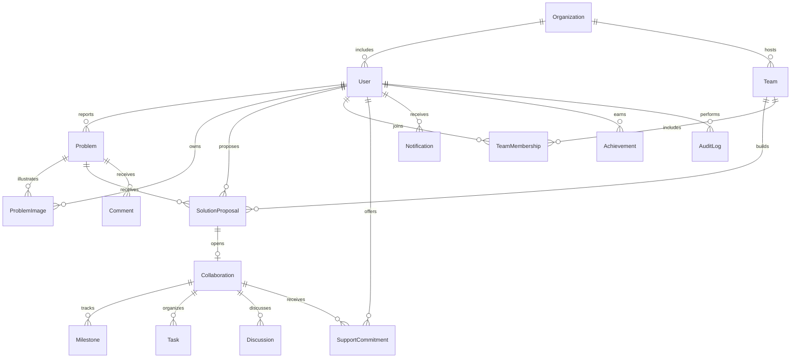

# CivicBridge architecture

CivicBridge is a MongoDB-backed Next.js App Router application using Prisma 6.19.3. It requires a MongoDB replica set for transactions and runs locally or on a Node.js host; it is not a static export. The SIH problem identifier is taken from the supplied brief and is not represented as an independently verified government affiliation.

## Layers

| Layer                                      | Responsibility                                                                                                          |
| ------------------------------------------ | ----------------------------------------------------------------------------------------------------------------------- |
| `src/app`                                  | Server-rendered landing and impact pages; interactive reporting, discovery, review, dashboard, and collaboration pages  |
| `src/components`                           | Shared design primitives, accessible form controls, maps, charts, status review, uploads, navigation                    |
| `src/app/api/platform/[...path]`           | HTTP resource routing, authorization, Zod validation, transactional mutations, consistent error responses               |
| `src/app/api/dashboard`                    | Role-scoped dashboard queries and rule-based matching                                                                   |
| `src/app/api/uploads`, `src/app/api/files` | Authenticated file ingestion and per-resource read permissions                                                          |
| `src/app/actions.ts`                       | Authenticated notification Server Action with Next.js origin checks and revalidation                                    |
| `src/auth.ts`                              | Auth.js credentials authentication, bcrypt verification, JWT session issuance                                           |
| `src/lib`                                  | Prisma singleton, live aggregate queries, lifecycle policy, matching, scoring, validation, session and security helpers |
| `prisma`                                   | MongoDB schema, reference and uniqueness indexes, repeatable opt-in demonstration seed                                  |

## Page structure

`/app` is the installable community experience, backed by the same Auth.js sessions, role-authorized posting forms, and Atlas APIs. The root manifest, app icons, service worker, responsive navigation, camera input, and explicit GPS action support phone users. The worker caches only public icons and a generic offline screen; no authenticated/API/RSC data or submission queue is stored. See [user app behavior](USER_APP.md).

Public pages: `/`, `/explore`, `/problems/[id]` (public lifecycle states), `/innovations`, `/innovations/[id]` (shortlisted onward), `/impact`, `/organizations`, `/leaderboard`, `/people/[id]`, `/login`, `/register`.

Authenticated pages: `/dashboard`, `/problems/new` (citizen/admin), `/solutions/new` (researcher/institution/admin), `/teams`, `/collaborations`, `/collaborations/[id]`, `/notifications`, `/settings`, `/admin` (admin only). Client entry screens give sign-in or role guidance; every protected API re-checks the active database user and current role. Hiding UI is not used as an access-control boundary.

## Data relationships

Additional entities are `Vote` (one per user/problem) and `RateLimit` (database-backed atomic counters). These relationships are indexed document references; MongoDB has no SQL foreign keys. Prisma emulates the explicitly configured cascade actions, while other relations use `NoAction`. Application mutations authorize and validate references. IDs map to MongoDB `_id` as strings, preserving the existing CUID/demo IDs, links, and references. `ProblemImage` also stores proposal documents; its resource associations control read access. File contents are BSON binary values, so uploads survive application restarts and do not require a shared local filesystem.

Nullable-field filters include both explicit `null` and MongoDB's missing-field case where either means “unassigned” or “unverified.” An indexed numeric `urgencyRank` preserves severity ordering because MongoDB stores urgency enum values as strings. The one-time transfer/backfill scripts were executed and removed after verification; ongoing index synchronization uses `prisma db push`, not SQL migrations.

## Permission and lifecycle rules

Reports: `REPORTED → UNDER_REVIEW → OPEN → COLLABORATION → PILOT → RESOLVED`. Admins can reject reports before collaboration. Authors can withdraw their own report while it is `REPORTED`; withdrawal preserves its audit history. A report needs an approved proposal before entering collaboration.

Proposals: `SUBMITTED → UNDER_REVIEW → SHORTLISTED → APPROVED → PILOT → COMPLETED`. Review stages allow rejection. Verified institutions can review their own organization's teams up to shortlisting; final approval and implementation transitions require an administrator. Approval creates exactly one workspace.

Private workspace access requires an active account and one of: proposal ownership, accepted membership in the proposal's team, an accepted partner commitment, or admin role. A pending support request grants no workspace access. The lead accepts or declines support and defines/completes milestones. Team members create tasks for themselves; only task owners/admins update them. Accepted partners can participate in discussion.

Status updates and important verification decisions write audit rows in the same transaction. Conditional status updates reject concurrent stale review actions. Unique `(userId, key)` achievement rows prevent repeat points; reports, votes, comments, and repeated submissions award no points. A completed milestone earns its project lead 20 points only after explicit administrator verification; verified milestones cannot be reopened or rewarded again.

## Intelligent features

- `/intelligence` compares a trained NYC311 descriptor baseline with keyword rules, including explanations, abstention, source/version hashes, held-out evaluation, and a separate synthetic bilingual model. Report assistance opts in through `AI_CLASSIFIER_MODE=local-model`; unsupported or low-evidence cases fall back to rules. See [the model card](AI_MODEL_CARD.md).
- `ImpactMeasurement` links a submitting user and collaboration. Team submissions record baseline/observed values, sample size, dates, method, and an HTTPS evidence link. They stay private until a different administrator verifies them. Conditional review updates, audit rows, and notifications share a transaction. `/evidence` additionally requires a public parent report. Review is not an independent scientific audit, and overlapping measurements are not summed.
- `/operations` and its API require administrator authorization. Up to 500 active reports receive visible urgency/population/age/community score components, internal review targets, location summaries, and formula-safe CSV export. Targets are not government response guarantees.

- Without an API key, category/urgency suggestions use labeled keyword rules. With `LLM_API_KEY`, the server calls an OpenAI-compatible chat-completions endpoint and validates its JSON output. Errors fall back to rules. Suggestions never automatically change reports.
- Duplicate discovery compares Jaccard token similarity against the latest 300 public reports, using a 100 km distance filter when coordinates are supplied. It is an approximate aid, not a guarantee of uniqueness.
- Matching combines declared category interests (60 points) and lexical skill overlap (up to 40 additional effective points, capped at 100). The recommendation pool is capped at 100 recent public/open reports. No private report text is exposed.
- Impact potential combines urgency (30), logarithmically scaled population (25), progress (30), and approved-solution readiness (15). This is explicitly an estimate, not verified impact measurement.

## Security boundaries

Auth.js handles authentication CSRF tokens and signed, HTTP-only JWT sessions. Sensitive platform mutations require an allowed Origin; production uses the canonical `AUTH_URL`. Development accepts localhost and 127.0.0.1 on the configured port. Protected endpoints re-read the user, so account deactivation immediately blocks access despite an existing token.

Passwords use bcrypt with 12 rounds. Registration cannot assign `ADMIN`. Input lengths, enumerations, geographic bounds, and file limits are validated server-side. MongoDB counters limit logins, registrations, writes, uploads, and assistance across application instances. Uploads permit JPEG/PNG/WebP/PDF with byte-signature and declared-type checks, no SVG/HTML, a 5 MB limit, sanitized filenames, and private file responses. PDFs are downloaded as attachments. Files are not malware-scanned; add scanning and image re-encoding for a public production service.

Public endpoints explicitly select author/profile fields and do not return email addresses or password hashes. Free-text reports remain the author's responsibility; UI guidance discourages posting private contact details. Admin user management is intentionally private.

## Verification strategy and limits

Production authentication and active-session checks reject demo accounts unless explicitly enabled. JSON and multipart uploads are bounded while streaming, including requests without Content-Length. New APIs use no-store responses and credential-safe error identifiers. `/api/health` and `/api/health/ready` support host probes; release checks validate secrets, canonical HTTPS origin, database transactions, and indexes. Integration tests require matching explicitly identified disposable local databases on both client and server before writes.

Unit tests validate scoring, assistance, similarity, geographic distance, lifecycle policies, urgency ranking, and input validation. Playwright's APIRequestContext tests exercise actual HTTP routes, authentication cookies, MongoDB persistence, visibility, missing upload-reference fields, sorting, uploads, moderation, proposal approval, partner acceptance, team invitations, matching, notifications, and duplicate reward prevention. No browser binaries are required by this suite.

The application does not include outbound email, payment processing, account recovery, real identity verification, real-time sockets, automated geographic address lookup, or claims of official university/government participation. In-app updates refresh after actions; cross-user screens fetch current state on load. Organization verification is an administrator's recorded decision, not external KYC. Public deployment should add email verification/recovery, production monitoring, backups, abuse review, and file scanning.
