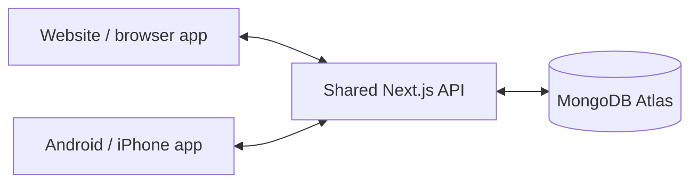

# One database for the website and native app

Both clients use **the same Next.js API and MongoDB Atlas database**. The native app has no separate database. `DATABASE_URL` is read only by the server; the app stores a revocable session credential and language preference, not an Atlas password or a second copy of community records.



## When changes appear

- Visible website views and focused, foreground native screens re-fetch every **five seconds**, plus request time.
- The server-rendered website home and impact summaries also refresh while visible and online, preserving browser scroll and client state.
- Returning to a screen, bringing the browser/app to the foreground, or reconnecting triggers a fresh read.
- A successful local mutation immediately invalidates other mounted queries in that client. Concurrent requests are serialized and coalesced; an old response cannot overwrite a newer one.
- Background polling retains the current view while it refreshes, so it does not remount forms or erase typed entries. Background network failures retain the last result until a successful refresh. Screens cannot synchronize while offline.
- Requests stop when a native screen loses focus or the app is backgrounded. Browser data polling pauses in hidden/offline tabs. Session checks also keep native account details and website session roles/names current.
- A 401/403/404 removes inaccessible cached records. Switching accounts resets query data. Normal role/privacy rules still apply: a pending report appears in its author's activity, while public discovery waits for moderation.

This is bounded foreground polling, not WebSockets, push notifications, background sync, or offline mutation replay. Multiple server replicas work because every read uses the shared Atlas database, without relying on one process's event memory. API responses and client fetches disable HTTP caching.

## Connect the installable Android preview locally

The local preview uses USB/ADB forwarding so the server remains on **127.0.0.1**. The same production server and Atlas configuration serve the browser and app. On Windows, stop any running CivicBridge servers before building so Prisma can replace its loaded engine DLL, then restart the shared server.

```powershell
# At the repository root; creates only public mobile connection settings
npm.cmd run mobile:connect
npm.cmd run build
npm.cmd run start:shared
```

In another PowerShell window, connect an Android phone with USB debugging enabled and authorize this computer:

```powershell
& "$env:LOCALAPPDATA/Android/Sdk/platform-tools/adb.exe" reverse tcp:3000 tcp:3000
& "$env:LOCALAPPDATA/Android/Sdk/platform-tools/adb.exe" install -r artifacts/CivicBridge-preview.apk
```

Open the website at `http://127.0.0.1:3000`, then open **CivicBridge Preview** on the phone. Keep the backend and USB connection running. The launcher disables demo-account authentication; use an existing real account or create your own account through the app/website. Public records marked Demo can still be browsed.

`npm.cmd run mobile:apk:local` regenerates the Android project through Expo config plugins, builds the two-architecture APK, and writes `artifacts/build-info.json` with its API origin and SHA-256 hash. It uses a debug signing certificate for local testing and is not a Play Store release. The build script uses installed Android/JDK tools and a pinned, checksum-verified portable Ninja to avoid Windows native-build path limits. Generated native files are not edited by hand.

LAN access is optional and has not been enabled: automatic approval review rejected the earlier network-visible Atlas/demo setup. The current launcher is localhost-only by default, and any LAN launch requires a separate explicit `--lan` request. Do not start a network-visible backend without reviewing who can reach it and obtaining authorization.

## Deploy both clients to the same service

Deploy the website/API once using the existing Atlas release process. Point `mobile` at **that website's HTTPS origin**, not a second backend or Atlas URI:

```powershell
cd mobile
$env:EXPO_PUBLIC_API_URL='https://your-civicbridge-host.example'
$env:EXPO_PUBLIC_LOCAL_PREVIEW='false'
npx.cmd eas-cli@latest build --platform android --profile production
```

The API origin is embedded in the binary, so rebuild after changing it. Local preview mode uses a separate `.preview` app identifier and is rejected for distributable EAS builds. See [native builds and iOS signing](NATIVE_APP.md).

## Proof and regression checks

`npm.cmd run test:sync` uses a real isolated local MongoDB replica set and the optimized backend. The native-component browser preview proxies to this actual API; it does not mock records or mutations. The test verifies native report creation appearing in the already-open website, comments in both directions, profile updates, and approval/rejection entering/leaving both public feeds without page reloads. No test records are written to Atlas.

The shared live-query unit tests cover serialized reads, mutation invalidation, background failures without loading-state resets, permission loss, and cancellation of stale account requests. Native-device checks are recorded separately from browser component tests in [validation](VALIDATION.md).

The actual APK was also installed and exercised on an isolated Android emulator: sign-in, three-step submission, saved values read through the website, and sign-out. `scripts/android-smoke.py` targets the isolated 1080×2400 Pixel 7 emulator on port 5556 and refuses non-loopback/non-test backends. `scripts/check-native-smoke.ts` verifies and removes the exact synthetic report with explicit disposable `DATABASE_URL`/`TEST_BASE_URL` settings. These are developer checks; do not run them against the Atlas application. A read-only signed-out Atlas feed check and visual capture followed the isolated write test.
