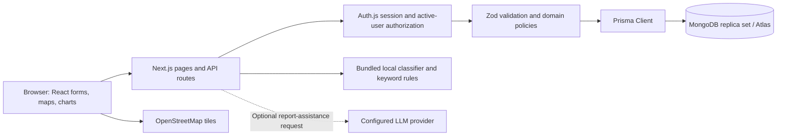
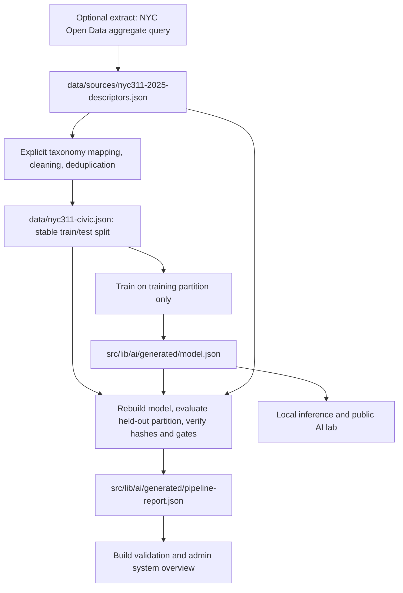

# CivicBridge: product, technology stack, and ETL pipeline

This guide describes the implementation in this repository. It separates deployed application behavior, offline model preparation, and work that still requires a hosting operator. CivicBridge is an independent civic innovation demonstrator, with no claimed government, university, or NYC endorsement.

## 1. What the product does

CivicBridge connects a local problem to a reviewed solution and then to implementation evidence. A citizen reports a challenge; researchers propose an approach; institutions review their teams; industry or NGO partners offer resources; administrators moderate publication and progress. An accepted project gets a private workspace. Teams can record outcomes, but only separately reviewed measurements enter the public evidence ledger.

The product is a single full-stack web application. It is not a collection of independently deployed microservices. Its HTTP APIs, authentication, server-rendered pages, and browser UI ship together. MongoDB is the persistent application database. The classifier is a bundled local artifact rather than a separately hosted machine-learning service.

### User roles

| Role           | Typical actions                                                                           | Boundary                                                                                               |
| -------------- | ----------------------------------------------------------------------------------------- | ------------------------------------------------------------------------------------------------------ |
| Citizen        | Report a problem, upload photos, track moderation, vote and comment                       | Newly submitted reports are private to their author and administrators                                 |
| Researcher     | Discover public problems, propose solutions, form teams, work on accepted projects        | A proposal's author or accepted team membership grants relevant workspace access                       |
| Institution    | Review affiliated teams and proposals                                                     | Verification and organization ownership are checked; final proposal approval requires an administrator |
| Industry / NGO | Offer expertise, mentorship, equipment, or funding interest                               | A pending offer does not grant workspace access; the lead must accept it                               |
| Administrator  | Moderate reports, approve proposals, verify organizations and milestones, review outcomes | Public registration cannot create administrators; trusted provisioning uses `admin:create`             |

Funding commitments are records of interest, not payment transactions. Organization verification is a recorded administrator decision, not an external identity/KYC service.

### An example journey

1. A citizen submits a water-shortage report with location, estimated population, and optional photos. The server validates fields and file ownership. The initial status is `REPORTED`.
2. An administrator moves it to `UNDER_REVIEW`, then `OPEN`. It becomes available to public discovery after moderation.
3. A researcher submits a proposal containing approach, technologies, resources, feasibility, and expected impact. An optional team and attachments are linked after permission checks.
4. The proposal proceeds through review and shortlisting to approval. Approval creates one private collaboration workspace and a unique contribution reward.
5. A partner submits a support request. The project lead accepts it before the partner can enter discussions.
6. Team members use milestones, tasks, discussions, and support commitments. Completion and verification are separate actions where required.
7. Administrators advance the report through collaboration and pilot to resolution. The proposal separately advances through pilot to completion.
8. A team submits baseline and observed measurements, dates, sample size, methodology, and an evidence URL. A different administrator verifies or rejects the measurement. Public evidence additionally requires a public parent report.

Status transitions, audit logs, and notifications are persisted. Important multi-record changes use MongoDB transactions; stale conditional updates are rejected rather than silently overwriting another reviewer's decision.

## 2. Technology stack: what is used where

Versions below are resolved from `package-lock.json` for this checkout, not merely the semver ranges in `package.json`. Install with `npm ci` to reproduce them.

| Technology                            | Resolved version                                   | Where it is used                                  | Why it is present                                                                       |
| ------------------------------------- | -------------------------------------------------- | ------------------------------------------------- | --------------------------------------------------------------------------------------- |
| Node.js                               | 24.14.1 in `.node-version`                         | Server, npm scripts, ETL, operational CLIs        | Shared JavaScript runtime with built-in fetch and environment-file support              |
| Next.js                               | 16.4.3                                             | `src/app`, `next.config.ts`                       | App Router pages, route handlers, Server Actions, production compilation                |
| React / React DOM                     | 19.3.1                                             | Pages and `src/components`                        | Forms, client-side state, interactive dashboards and views                              |
| TypeScript                            | 5.9.3                                              | Application and operational scripts               | Static checking under the strict repository configuration                               |
| Tailwind CSS                          | 4.3.3                                              | `src/app/globals.css`, PostCSS                    | Styling utilities alongside the established custom design system                        |
| Prisma Client / CLI                   | 6.19.3                                             | `src/lib/db.ts`, `prisma/schema.prisma`           | Typed queries and transactions over MongoDB, plus index synchronization                 |
| MongoDB                               | Local verification uses 8.2; Atlas is configurable | All persistent application collections            | Documents, indexed references, audit history, counters, and uploaded binary files       |
| Auth.js / `next-auth`                 | 5.0.0-beta.32                                      | `src/auth.ts`, auth route, session helpers        | Credentials authentication and signed JWT sessions; this is a pinned beta dependency    |
| `bcryptjs`                            | Lockfile-pinned                                    | Registration, login, seed, administrator CLI      | Password hashing and comparison; application hashes use cost 12                         |
| Zod                                   | 4.6.7                                              | `src/lib/validation.ts`, evidence and API schemas | Server-side input validation and model dataset validation                               |
| Leaflet / React Leaflet               | Lockfile-pinned                                    | Map components                                    | Report coordinates, location selection, and public map discovery                        |
| OpenStreetMap                         | External browser tile service                      | Map backgrounds                                   | Geographic context with attribution; not a geocoding/address lookup service             |
| Recharts                              | Lockfile-pinned                                    | `src/components/charts.tsx`                       | Visual summaries from application aggregates                                            |
| Radix Slot, CVA, clsx, tailwind-merge | Lockfile-pinned                                    | Shared button and utility primitives              | Component composition and consistent class variants                                     |
| Lucide React                          | Lockfile-pinned                                    | Navigation, cards, actions                        | Icons                                                                                   |
| next-themes / Sonner                  | Lockfile-pinned                                    | Providers and interactive actions                 | Theme selection and user feedback                                                       |
| Vitest                                | 4.1.12                                             | `tests/unit`                                      | Domain, validation, classifier, security, and pipeline lineage tests                    |
| Playwright                            | 1.64.1                                             | `tests/integration`, configuration                | Authenticated HTTP/database workflow tests using API request contexts                   |
| Prettier                              | Lockfile-pinned                                    | Formatting scripts and CI                         | Consistent source formatting                                                            |
| Docker / GitHub Actions               | Repository configuration                           | `Dockerfile`, `.github/workflows/ci.yml`          | Portable packaging and automated validation; not a deployed cloud service by themselves |

The machine-learning implementation is TypeScript Multinomial Naive Bayes. This project does not use Python, TensorFlow, PyTorch, a vector database, embeddings, a RAG pipeline, Kafka, Airflow, Spark, or a data warehouse. The optional LLM path uses server-side HTTP against an OpenAI-compatible endpoint; no provider SDK is required.

The deployment preparation updates Auth.js to beta.32 for its [upstream security fixes](https://github.com/nextauthjs/next-auth/releases/tag/next-auth@5.0.0-beta.32), and Prisma to 6.19.3, which brings patched Effect tooling. A scoped npm override pins `@prisma/config`'s `deepmerge-ts` dependency to 8.0.0 for the [recursive-merge advisory](https://github.com/advisories/GHSA-ggr8-5vv4-36mx). This stays on Prisma 6 instead of applying a forced major upgrade. The override crosses a dependency major version: the application does not use Prisma configuration Maps affected by v8's merge behavior, and Prisma generation, schema validation, database workflows, and the production build need verification whenever it changes. CI audits the full dependency tree, including operator tools retained in the Docker image.

### Rendering and request flow



`src/app/page.tsx` and other server pages read live aggregates where appropriate. Interactive screens use `src/lib/client.ts` to fetch API data. Route handlers use the Node server runtime. A singleton Prisma client avoids constructing a fresh client on every request during development reloads.

There are no WebSocket subscriptions or push events. A user's own actions reload relevant views; another user's changes appear when a view fetches again. Notifications are in-app database records, not outbound email or SMS.

## 3. Source code map

| Path                                                              | Responsibility                                                                                            |
| ----------------------------------------------------------------- | --------------------------------------------------------------------------------------------------------- |
| `src/app/api/platform/[...path]/route.ts`                         | Main resource API: registration, reports, proposals, teams, collaboration, moderation, and profiles       |
| `src/app/api/dashboard/route.ts`                                  | Current-user dashboard and matching                                                                       |
| `src/app/api/uploads/route.ts`, `api/files/[id]/route.ts`         | Validated upload ingestion and resource-authorized downloads                                              |
| `src/app/api/evidence/route.ts`                                   | Measurement submission, access, and independent reviewer workflow                                         |
| `src/app/api/operations/route.ts`                                 | Admin report ranking and filtered, formula-safe CSV export                                                |
| `src/app/api/system/route.ts`                                     | Admin-only read-only database transaction, sanitized configuration checks, and bundled ETL report         |
| `src/app/api/intelligence/route.ts`                               | Model card and authenticated local classifier demonstration                                               |
| `src/app/api/health/route.ts`, `api/health/ready/route.ts`        | Liveness and bounded readiness probes                                                                     |
| `src/lib/domain.ts`, `validation.ts`, `session.ts`, `security.ts` | Lifecycle policy, scoring, validation, current access checks, origins and rate limits                     |
| `src/lib/impact-evidence.ts`, `operations.ts`                     | Outcome calculations and explainable administrative priority/filter policy                                |
| `src/lib/ai/naive-bayes.ts`, `assistance.ts`                      | Tokenization, training, inference, evaluation, abstention, and report-assistance fallback                 |
| `src/lib/ai/pipeline.ts`                                          | Reconstructed training/evaluation, lineage validation, and quality gates                                  |
| `src/lib/ai/generated/`                                           | Public classifier, separate synthetic demo classifier, deterministic pipeline report                      |
| `scripts/`                                                        | ETL, configuration/database checks, administrator provisioning, local database lifecycle, and maintenance |
| `prisma/schema.prisma`                                            | Database models and indexes; `prisma/seed.ts` is opt-in demo content                                      |
| `data/`                                                           | Public source snapshot, transformed dataset, separate synthetic dataset, and attribution                  |

## 4. Application database and persistence

The principal models are `User`, `Organization`, `Problem`, `ProblemImage`, `SolutionProposal`, `Team`, `TeamMembership`, `Collaboration`, `Milestone`, `Task`, `Discussion`, `Comment`, `Vote`, `Notification`, `SupportCommitment`, `Achievement`, `AuditLog`, `RateLimit`, and `ImpactMeasurement`.

IDs are string values mapped to MongoDB `_id`. Relations are indexed references, not SQL foreign keys. The application validates references and access; Prisma emulates explicitly configured cascades. Code accounts for both missing and explicit-null optional MongoDB fields. The numeric `urgencyRank` preserves severity sorting because the urgency enum itself is stored as text.

Unique indexes prevent duplicate team memberships, multiple workspaces for one proposal, repeated votes, duplicate partner requests, and repeated contribution awards. Useful compound indexes cover report visibility/category/city and urgency/age queries. Index changes use `prisma db push`; Prisma Migrate's SQL migration workflow is not used for this MongoDB connector. Future document backfills require explicit reviewed scripts and backups.

Image and document bytes live in `ProblemImage` binary fields. The application does not depend on a persistent upload directory or an S3 bucket. Files are limited to 5 MB each and checked for supported MIME/byte signatures. Access follows the associated report or proposal. PDFs download as attachments. This design needs storage monitoring and a future file-scanning step for unrestricted public operation.

## 5. What ETL means in this project

ETL means **Extract, Transform, Load**. Here it prepares the public training corpus and classifier. It is a batch build/developer workflow, not a continuous import of municipal tickets into the product's operational database.

There are two distinct data flows:

1. Application records: user actions → validated API mutations → MongoDB → live product queries.
2. Classifier artifacts: public municipal aggregate snapshot → cleaned labeled examples → deterministic model and evaluation → versioned JSON bundled into the app.

The classifier pipeline does not read private citizen reports, passwords, uploaded photos, or the Atlas application database. It does not create `Problem` records from NYC311 requests. Application impact/operations pages compute MongoDB queries; they are not materialized warehouse ETL outputs.



### Extract: retrieve aggregate source data

`scripts/fetch-civic-data.mjs` queries NYC Open Data's `erm2-nwe9` resource. The query selects `complaint_type`, `descriptor`, and `count(*) AS records`, grouped and ordered by complaint type/descriptor. Its time window is calendar year 2025, with non-null descriptors and a 10,000-row limit. An empty or limit-sized response is rejected, because it could represent an invalid/truncated snapshot.

The extractor checks HTTP status and validates the expected fields and positive integer counts before replacing the snapshot through a temporary file. It stores the exact query URL, retrieval timestamp, source identifier, selected fields, terms URL, and reuse-policy URL. Only those three aggregate fields are downloaded: no individual narratives, request identifiers, locations, names, or phone numbers.

The checked-in snapshot contains 1,121 aggregate descriptor pairs. A source request count is metadata; the trainer does not treat it as thousands of independent samples or use it as a weight. Refreshing the source is deliberately explicit, so upstream revisions do not silently change a normal application build.

### Transform: map, clean, deduplicate, split

`scripts/prepare-civic-data.mjs` maps known complaint types to six project categories: Waste Management, Water Conservation, Infrastructure, Environment, Public Safety, and Transportation. School building maintenance maps to Infrastructure. There are no fabricated municipal training examples for Education, Agriculture, Healthcare, or Other.

The transformation removes agency routing codes and selected template suffixes, collapses whitespace, and ignores very short descriptors. Its duplicate key uses Unicode NFKC normalization, lowercase text, and letters/numbers/combining marks with punctuation removed. Phrases mapped to conflicting labels are excluded; the current snapshot excludes five ambiguous descriptors.

The split is assigned from SHA-256 of `civicbridge-nyc311-v1:` plus the normalized phrase, modulo five. Bucket zero is held out; the others train. This is an expected 20% test allocation, not an exact count constraint. Sorting and a fixed split key make repeated preparation deterministic and keep exact normalized descriptors out of both partitions.

| Category           | Train | Held out |
| ------------------ | ----- | -------- |
| Waste Management   | 37    | 8        |
| Water Conservation | 40    | 7        |
| Infrastructure     | 135   | 45       |
| Environment        | 71    | 14       |
| Public Safety      | 14    | 6        |
| Transportation     | 94    | 32       |
| Total              | 391   | 112      |

The transformed dataset carries the source file's SHA-256 fingerprint, attribution, timestamp, mapping policy, split description, exclusions, and limitations. Similar templates and shared vocabulary can still span partitions; descriptor separation does not prove field generalization.

### Train and evaluate

`scripts/train-ai.ts` validates dataset metadata and category groups with Zod. `trainClassifier` rejects duplicate IDs and normalized text, checks partition coverage for every category, and learns only from training examples. Unicode word tokens preserve Hindi characters for the separate demo dataset. The model adds adjacent word bigrams, removes a small stopword list, and applies Laplace smoothing to per-category token counts.

The public trainer now compares six predefined word-only/word-plus-character multinomial/complement candidates using five-fold stratified cross-validation **within the training split only**. Vocabulary and counts are fitted separately per fold; mean macro F1 selects the winner before the reserved test set is evaluated. The selected Complement Naive Bayes model includes word/bigram and weighted character 3–5-gram features. Its validation comparisons and selected configuration are stored in the artifact and independently reconstructed by release checks.

Prediction ranks log-space likelihood scores (complement likelihoods for the selected variant). Normalized scores are uncalibrated. Inference abstains below two known features, 15% feature coverage, or a 0.15 top-two margin. Explanations show vocabulary cues, not causal proof. These thresholds are fixed demonstrator choices, not calibrated field guarantees.

Held-out evaluation reports top-ranked accuracy even for abstained examples, macro F1, confusion matrix, category precision/recall, abstention/coverage, accepted-only accuracy, and a majority baseline. The retrained model scores 63.4% accuracy, macro F1 0.522, coverage 81.3%, and accepted-only accuracy 73.6%; the majority baseline is 40.2%. Compared with the original 59.8% / 0.503 model, overall accuracy improved and abstentions decreased, while accepted-only accuracy fell from 75.7%. See the model card for the full comparison and domain limits.

These results describe English NYC structured descriptors. They do not establish accuracy for Indian citizen narratives, Hindi, unseen cities, or unsupported categories. The separate authored bilingual synthetic demo has 80 training and 20 test examples; its evaluation remains separate from municipal-data claims. See `AI_MODEL_CARD.md` for details.

### Load and promotion

The load destination is `src/lib/ai/generated/model.json`. The artifact contains learned counts plus its model card, source/dataset fingerprints, evaluation, supported categories, and limitations. It is versioned with the source and dataset and loaded locally by the application. There is no model registry, training endpoint, background training service, or automatic production promotion.

`check-pipeline.ts` independently rebuilds the expected model, recomputes evaluation, verifies both fingerprints and retrieval timestamp, and rejects inconsistent weights/cards. Its baseline gates require accuracy greater than the majority baseline, macro F1 at least 0.45, and coverage at least 0.50. These are artifact-regression checks; they are not evidence of deployment suitability or regional fairness. Retraining should not lower gates simply to pass a new dataset.

The deterministic pipeline report records hashes, counts, category coverage, metrics, and thresholds. The build runs the read-only `etl:check` and fails on stale or inconsistent artifacts. `/system` shows the bundled report to administrators; refresh checks application state, not upstream data or a new training run.

### Commands, scheduling, and failures

```powershell
# Offline reproducibility: prepare, train, validate, write report.
npm.cmd run etl
# Read-only lineage, weights, metrics, gate, and bundled-report validation.
npm.cmd run etl:check
# Explicit network refresh, followed by the same preparation/training/checks.
npm.cmd run etl -- --refresh
# Separate synthetic demonstration artifact; never mixed into public evaluation.
npm.cmd run ai:train:demo
```

The runner stops on the first failed stage. It writes local working-tree artifacts, not application database records. A later stage failure can leave earlier generated files changed: inspect the diff and rerun or restore the intended snapshot before release. The stale-report build check prevents silently shipping that partial state. Do not run two ETL refreshes concurrently in the same checkout; use a dedicated branch/workspace for a data update.

ETL has no automatic schedule by default. CI reproduces preparation and training from the pinned snapshot without calling the upstream dataset API, verifies outputs, then runs release checks. An operator can schedule refresh proposals in a separate workflow after deciding cadence, review ownership, and source policy. A changed snapshot/model should be reviewed together, committed deliberately, and deployed as an application release. To roll back inference, deploy the prior complete artifact set/application release; no application database rewrite is involved.

## 6. AI assistance and other intelligence

The default reporting assistant uses labeled keyword rules for category and urgency. `AI_CLASSIFIER_MODE=local-model` opts into the municipal classifier after reviewing its limits; abstentions and unsupported coverage fall back to rules. The synthetic demo stays separate in the lab. Suggestions remain editable and never automatically publish a report.

If `LLM_API_KEY` is configured, the report-assistance route can send the user's text to the configured server-side OpenAI-compatible endpoint. The output is validated, and timeouts/provider errors fall back locally. The public AI lab performs local inference; it does not call that provider. All provider credentials must remain server-side.

Other intelligence is explicit application logic: duplicates use approximate token overlap and location distance; researcher matching combines declared interests and lexical skills; estimated impact combines urgency, population, lifecycle progress, and solution readiness. None of these is an externally validated causal impact estimate. The evidence ledger separately stores reviewer-approved observations and does not sum potentially overlapping measurements.

## 7. Access control and operations

Auth.js issues HTTP-only JWT sessions with a 24-hour lifetime. Protected APIs re-read the active user and role from MongoDB, so a deactivated account or disabled demo user cannot rely solely on a previously issued token. Passwords are hashed, email addresses/password hashes are omitted from public projections, and administrator creation is restricted to an operator CLI.

Mutations check the request Origin against the configured canonical origin. Server schemas bound field lengths/enums/coordinates, and streamed body readers cap JSON and multipart requests. Database-backed rate limits work across instances. Workspace access requires ownership, accepted team membership, an accepted support commitment, or administrator status. A pending invitation/offer grants no access.

`/operations` ranks up to 500 active reports by urgency and age selection, with visible urgency/population/age/community score components. Search, urgency, stage, overdue-only, and hide-demo filters apply consistently to displayed items and CSV exports. The export re-reads the latest queue, so concurrent changes can alter its rows. Metrics and hotspots summarize the ranked sample; `total` counts all active reports. Internal review targets are not government service guarantees.

`/system` and `/api/system` are administrator-only. They expose a read-only database transaction result, review counts, sanitized release-configuration issues, assistance/demo modes, and the bundled ETL report. They do not return connection URIs, authentication secrets, account emails, or raw environment variables. Passing these checks is not a substitute for backups, index verification, external uptime monitoring, or a production smoke test.

## 8. Deployment architecture and release flow

Supported packaging includes a normal Node.js server, the Render/Railway manifests, and the Dockerfile. The app cannot be served by GitHub Pages or another static-only host. It needs MongoDB with replica-set transactions, such as Atlas, plus authenticated/TLS database connectivity appropriate to the host.

Builds install pinned dependencies, generate Prisma Client, validate ETL, and compile Next.js. `release` checks production settings, verifies a read-only application transaction, and synchronizes indexes without accepting destructive changes automatically. Hosted startup listens on `0.0.0.0` and honors `PORT`. The Docker image runs as the unprivileged `node` user and receives secrets only at runtime. It retains Prisma/tsx tools for operational commands, so it favors an operationally complete image over minimal size.

Required host settings are `DATABASE_URL`, random `AUTH_SECRET`, the exact public HTTPS `AUTH_URL`, `AUTH_TRUST_HOST=true` behind a controlled proxy, and production demo-account policy. The local `.env` is excluded from Git and Docker. `.env.example` contains placeholders. Do not seed shared demo credentials in a real deployment.

`/api/health` indicates the process can answer. `/api/health/ready` checks MongoDB availability with a bounded wait and short cache. The readiness endpoint does not prove every index or business workflow. Monitor it from the host; perform authenticated post-deployment smoke tests separately. Schedule `maintenance` to remove expired rate-limit counters and old unattached files, and configure Atlas backups and restore drills.

See [DEPLOYMENT.md](DEPLOYMENT.md) for host steps and Docker commands. A ready repository is not a published application: a hosting account, real domain, runtime secrets, Atlas network access, and trusted administrator still need configuration.

## 9. Verification and remaining scope

Unit tests exercise domain/security behavior and deliberate ETL tampering: source/dataset drift, changed weights, inflated metrics, partition leakage, and provenance substitution. The integration suite checks actual authentication, role access, privacy, workflow mutations, audit/reward protections, evidence review, filtered exports, system API secrecy, and health against a disposable local database. CI runs HTTP workflows against development and optimized production servers and builds the container.

The Playwright suite uses HTTP request contexts, not visual browser interaction. Responsive layout, keyboard operation, maps/charts, dark mode, and the optional remote provider require separate verification. Record actual results in `VALIDATION.md`; a configured workflow alone is not evidence that GitHub Actions or Docker has run successfully.

| Area         | Implemented                                                                      | Further work                                                                       |
| ------------ | -------------------------------------------------------------------------------- | ---------------------------------------------------------------------------------- |
| Core product | Reporting, discovery, proposal review, teams, private collaboration              | Pilot-specific acceptance criteria and user research                               |
| Evidence     | Private submissions, independent reviewer rule, audit and public verified ledger | External methodology review and overlapping-outcome policy                         |
| Operations   | Ranked queue, filters/export, system overview, health                            | Incident ownership, alerting, retention and backup operations                      |
| AI/data      | Reproducible baseline, provenance, regression gates, fallback                    | Reviewed Indian data, language/region evaluation, calibration and drift policy     |
| Accounts     | Credentials, role checks, inactive/demo restrictions                             | Email verification, recovery, session-management product flows                     |
| Uploads      | Type/signature/size/ownership checks, private persistence                        | Malware scanning and image re-encoding                                             |
| Delivery     | Git-ready source, CI, host manifests, container recipe                           | Run CI remotely, choose/configure host, provision admin, verify hosted smoke tests |

These remaining items require product decisions or external infrastructure. They are not represented as working features in the current application.
